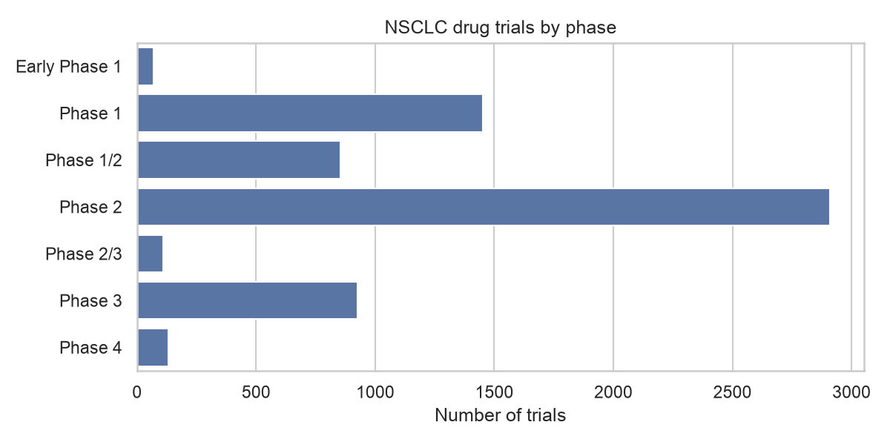
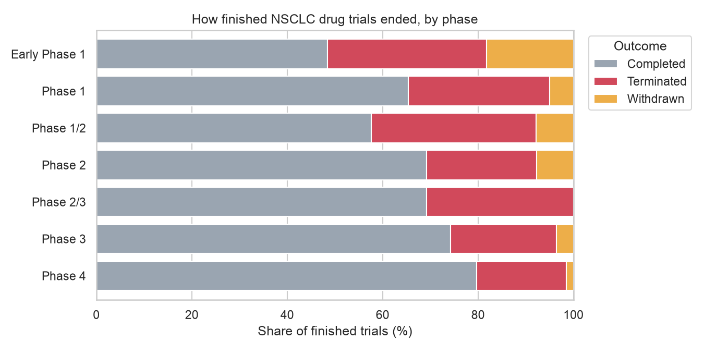
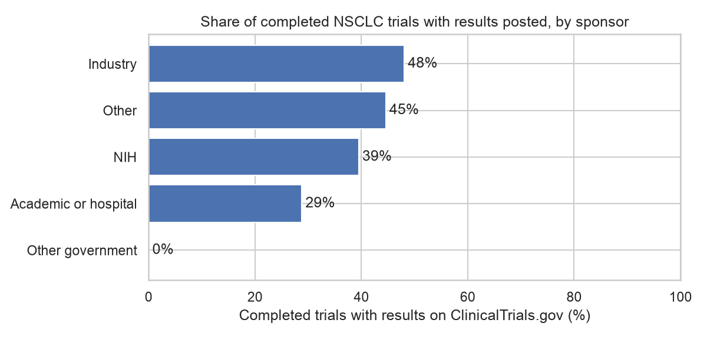

# NSCLC Clinical Trial Landscape Analysis

What does the drug development pipeline for non-small cell lung cancer (NSCLC) look like? This project downloads every NSCLC study registered on ClinicalTrials.gov, cleans it into an analysis-ready dataset, and answers six questions about phases, sponsors, outcomes, trial size and results transparency.

## Key findings

1. **Phase 2 dominates the pipeline.** Phase 2 is the most common phase among NSCLC drug trials, with far fewer trials reaching Phase 3 ([N] Phase 2 vs [N] Phase 3).
2. **Later phases stop early less often.** Among finished trials, the share terminated or withdrawn falls from 34.6% in Phase 1 to 25.7% in Phase 3. Combined Phase 1/2 trials stop early most often (42.4%).
3. **Most early stops are not about the drug failing.** A sample of stated reasons points mainly to slow recruitment, funding and sponsor strategy decisions rather than safety or efficacy.
4. **Industry posts results far more often than academia.** 48.0% of completed industry trials have results on ClinicalTrials.gov, vs 28.8% of academic trials. The gap holds within every phase and is largest in Phase 3 (70% vs 18%).
5. **Posting improved after 2008, least for academic sponsors.** For trials starting in 2008 or later (when U.S. results reporting under FDAAA Section 801 began), industry posting rose from 34% to 53%, academic posting only from 24% to 32%.







## Data

- **Source:** [ClinicalTrials.gov API v2](https://clinicaltrials.gov/data-api/about-api), downloaded October 29, 2026
- **Search:** condition = "non-small cell lung cancer"
- **Size:** 8,636 studies downloaded; [N] interventional trials after cleaning
- ClinicalTrials.gov updates daily, so rerunning the pipeline will give slightly different numbers.

## Methods

1. **Download.** `fetch_all_studies()` requests 1,000 studies per page and follows `nextPageToken` until all matching studies are retrieved. Raw JSON is saved to `data/raw/` (not committed).
2. **Flatten.** `flatten_study()` turns each nested study record into one row with 11 fields: ID, title, status, start date, reason stopped, study type, phases, enrollment, lead sponsor, sponsor class and whether results are posted.
3. **Clean.** Kept interventional trials only; extracted start year from mixed date formats; mapped phase codes to readable labels (e.g. `PHASE1,PHASE2` to "Phase 1/2"); grouped sponsors into Industry, Academic or hospital, NIH, Other government and Other. The phase code `NA` ("not applicable") is read as text, not as missing data.
4. **Verify.** Checked for duplicate trial IDs, and spot-checked random rows against the live API and the ClinicalTrials.gov website.
5. **Analyze.** Six questions, one figure each:

| Question | Method | Figure |
| --- | --- | --- |
| How many trials are in each phase? | Counts by phase | `01_trials_by_phase.png` |
| How has trial activity changed over time? | Trials per start year, 2000 to 2025 | `02_trials_per_year.png` |
| Who sponsors each phase? | Sponsor share within each phase | `03_sponsor_by_phase.png` |
| Which phase stops early most often? | Outcomes of finished trials by phase | `04_outcomes_by_phase.png` |
| How big are trials in each phase? | Enrollment box plots, log scale | `05_enrollment_by_phase.png` |
| Do sponsors post their results? | Results-posted share of completed trials, by sponsor, phase and era | `06_results_posted_by_sponsor.png` |

## How to run it

Requires [uv](https://docs.astral.sh/uv/).

```bash
git clone https://github.com/roadtoemploy1/clinical-trial-explorer
cd clinical-trial-explorer
uv sync
uv run python src/build_dataset.py
```

This downloads the data and writes `data/processed/nsclc_trials_clean.csv`. Then open `notebooks/03_analysis.ipynb` and run all cells.

## Repository structure

```text
clinical-trial-explorer/
├── data/
│   ├── raw/              # API downloads (not committed)
│   └── processed/        # cleaned CSVs
├── notebooks/
│   ├── 01_explore_api.ipynb
│   ├── 02_build_dataset.ipynb
│   └── 03_analysis.ipynb
├── src/
│   └── build_dataset.py  # download, flatten and clean
└── figures/
```

## Limitations

- **Not all interventional trials test drugs.** The dataset includes screening, device and procedure trials. For example, the largest trial (53,454 participants) is the National Lung Screening Trial, which compared CT scans with chest X-rays. Filtering on primary purpose = treatment would sharpen the drug pipeline view.
- **Condition search is broad.** Some trials enroll several tumor types at once, not only NSCLC.
- **Older years are undercounted.** Registration became widely required in the mid-2000s.
- **Enrollment mixes planned and actual numbers.** Ongoing trials report planned enrollment.
- **Results posting is measured on ClinicalTrials.gov only.** Results published in journals are not counted, and many trials (Phase 1, non-U.S., older) were never required to post.
- **Era is approximated by start year.** Posting rules depend mainly on completion date.

## Tools

Python (requests, pandas, matplotlib, seaborn), Jupyter, uv, Git and GitHub.

## What I learned

Working with a real API taught me that most of the effort goes into understanding and cleaning the data, not plotting it. Spot checks against the source caught issues that no error message would have, and checking whether a pattern holds within subgroups (phase, era) turned a simple comparison into a more convincing finding.
